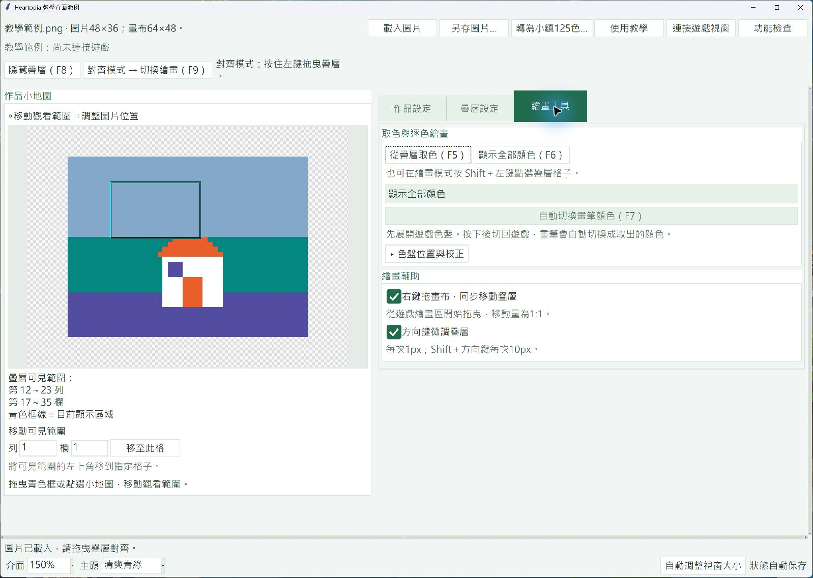

# Heartopia 繪畫疊層小幫手

Heartopia Painting Overlay Helper

在《心動小鎮》（Heartopia）的畫布上顯示參考圖片，協助玩家對照格子、逐色手動繪畫。

**[線上圖文教學](https://wingkawa.github.io/heartopia-painting-overlay-helper/)**：依步驟完成圖片準備、校正、對齊與繪畫。免安裝版另附相同的離線教學，可從工具中的「使用教學」開啟。



## 下載 Windows 免安裝版

**[下載 Windows 免安裝版 0.1.2](https://github.com/WingKawa/heartopia-painting-overlay-helper/releases/download/v0.1.2/HeartopiaPaintingOverlayHelper-0.1.2-windows-x64.zip)** · [版本說明與下載頁面](https://github.com/WingKawa/heartopia-painting-overlay-helper/releases/tag/v0.1.2)

- 適用 **Windows 10／11，64 位元（x64）**，不需另外安裝 Python。
- 一般使用者請下載 `HeartopiaPaintingOverlayHelper-0.1.2-windows-x64.zip`。
- **`Code → Download ZIP`、`Source code (zip)` 及 `Source code (tar.gz)` 都是原始碼，並非免安裝版。**

## 快速開始

1. 將免安裝 ZIP **完整解壓縮**，保留整個資料夾。
2. 雙擊 `HeartopiaPaintingOverlayHelper.exe`。
3. 按「使用教學」，依照圖文指示操作。

| 階段 | 操作 |
| --- | --- |
| 載入圖片 | 準備小鎮可用的 125 色像素圖，或使用「轉為小鎮125色」轉圖。 |
| 設定畫布 | 設定寬高，透過小地圖調整圖片位置與觀看範圍。 |
| 連接與校正 | 按「連接遊戲視窗」後點回遊戲。打開畫布，讓格線清楚可見，再依教學截圖量測格子。 |
| 對齊疊層 | 顯示疊層，在對齊模式拖曳，讓疊層格子與遊戲格子重合。 |
| 取色繪畫 | F9 切換繪畫模式，F5 取色後逐色手動填入；F6 顯示全部顏色。 |

- [文字使用說明](docs/USAGE.txt)
- [離線圖文教學原始檔](docs/guide/index.html)：下載後用瀏覽器開啟；GitHub 檔案預覽不會直接顯示互動網頁。
- [更新紀錄](CHANGELOG.md)

## 功能

- 圖片轉為小鎮 125 色，支援裁切、色彩調整及 PNG 另存。
- 自訂作品畫布，小地圖構圖及觀看範圍。
- 疊層對齊、單色提示、格子尺寸與色盤位置校正。
- 可選用右鍵拖曳同步、方向鍵微調及自動選色。
- 保存作品與操作設定，四種主題，功能檢查與診斷紀錄匯出。

## 使用前須知

本工具為非官方第三方工具，未取得遊戲營運方的使用許可或背書。是否允許使用本工具及其各項功能，以適用版本的最新官方協議、公告及營運方判定為準；無法保證使用後不會收到警告、功能限制或帳號停權等處置，請自行評估並承擔相關風險。

自動選色預設關閉，需閱讀說明並明確啟用。每次按下選色按鈕或 F7 後，工具會等待玩家切回遊戲，再操作滑鼠切換畫筆顏色。執行期間請暫停操作滑鼠，等待完成；可按 Esc 取消。關閉自動選色不代表其他輔助功能已獲官方允許。

本工具不讀取或修改遊戲程序記憶體、遊戲存檔，也不存取遊戲帳號系統或取得登入憑證。工具會讀取視窗資訊並觀察相關鍵盤、滑鼠操作；自動選色會暫時擷取遊戲畫面辨識色盤，校正功能使用你貼上的截圖。校正與選色的截圖不會自動儲存或上傳。作品快照、設定與診斷紀錄保存在本機，診斷紀錄由玩家自行決定是否匯出提供。

[官方規章與資料使用說明（離線教學）](docs/guide/index.html#rules-and-privacy) 列出協議第 8.2～8.5 條重點及資料用途。

## 已知限制與問題回報

- 拖曳畫布後，疊層可能與遊戲畫布偏移，請自行確認。有偏移時可用方向鍵微調，或按 F9 重新對齊。
- 快捷鍵、同步拖曳或自動選色沒有反應時，可開啟「功能檢查」。若遊戲以系統管理員身分執行，請關閉工具，再對工具執行檔按右鍵，選「以系統管理員身分執行」。
- 回報時請提供版本、操作步驟、預期與實際情況、發生時間。可從「功能檢查」匯出診斷 ZIP 一併提供；紀錄可能包含檔名與視窗標題，提供前請自行確認。

## 從原始碼執行

以以下指令取得原始碼，或下載原始碼 ZIP 後解壓縮。需安裝 Windows x64 Python 3.10 或更新版本；已驗證環境為 Python 3.10.8。

```powershell
git clone https://github.com/WingKawa/heartopia-painting-overlay-helper.git
cd heartopia-painting-overlay-helper
```

```powershell
python -m venv venv
.\venv\Scripts\python.exe -m pip install -r requirements.txt
.\venv\Scripts\python.exe run_assist.py
```

開發與測試：

```powershell
.\venv\Scripts\python.exe -m pip install -r requirements-dev.txt
.\venv\Scripts\python.exe -m pytest
```

封裝設定見 [assist.spec](assist.spec)，步驟見[建置與發行說明](docs/BUILDING.md)。`Start-Assist.vbs` 可在已有 `venv` 環境時免終端視窗啟動。

目前入口為 `run_assist.py`，或在 Python 可找到 `src` 套件時使用 `python -m heartopia_overlay`。[開發說明](docs/DEVELOPMENT.md) 列出目前的模組分工與輸入行為範圍。

## 開源授權與第三方內容

本專案自行撰寫的程式碼採用 [MIT License](LICENSE)，允許使用、修改、再散布及商用，須保留版權與授權聲明。此授權不取代遊戲規章，也不授予遊戲素材、商標或其他作者作品的權利。

套件與素材來源見 [第三方聲明](THIRD_PARTY_NOTICES.md)。目前色盤由遊戲截圖獨立量測，附原圖、取樣範圍及重建腳本。工具教學使用本專案程式繪製的小屋範例；遊戲畫面另保留原權利人的權利。免安裝版附各元件授權原文。
